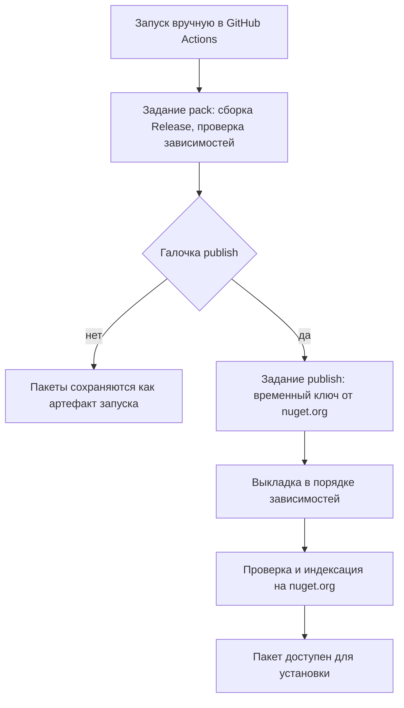

# Публикация пакетов на NuGet

Библиотеки AIFramework выходят на [nuget.org](https://www.nuget.org/profiles/ZaharPonimash) под учетной записью `ZaharPonimash`. Выкладка выполняется в GitHub Actions по технологии Trusted Publishing, поэтому постоянных ключей нет ни в репозитории, ни в настройках GitHub.

## Содержание

- [Как это устроено](#как-это-устроено)
- [Выпуск новой версии](#выпуск-новой-версии)
- [Что происходит после выкладки](#что-происходит-после-выкладки)
- [Как следить за пакетами](#как-следить-за-пакетами)
- [Что входит в публикацию](#что-входит-в-публикацию)
- [Новая библиотека](#новая-библиотека)
- [Настройка Trusted Publishing](#настройка-trusted-publishing)
- [Вход на nuget.org](#вход-на-nugetorg)
- [Безопасность](#безопасность)
- [Проверка пакетов на своей машине](#проверка-пакетов-на-своей-машине)
- [Запасной путь с ключом](#запасной-путь-с-ключом)
- [Как скрыть или исправить версию](#как-скрыть-или-исправить-версию)
- [Частые проблемы](#частые-проблемы)

## Как это устроено



Рабочий процесс запускается только вручную: выложенную версию нельзя удалить, поэтому случайный запуск после коммита исключен.

| Файл | Назначение |
|------|------------|
| [.github/workflows/publish-nuget.yml](../.github/workflows/publish-nuget.yml) | Рабочий процесс: сборка, временный ключ, выкладка. |
| [build.ps1](../build.ps1) | Команда `-Pack` собирает пакеты в `artifacts/nuget`, каталог очищается перед сборкой. |
| [build/nuget-push.ps1](../build/nuget-push.ps1) | Проверяет зависимости, определяет порядок и выкладывает пакеты. |
| [Directory.Build.props](../Directory.Build.props) | Версия, автор, лицензия, адрес репозитория. |
| [build/NuGet.props](../build/NuGet.props) | Описания пакетов, теги, иконка, README. |
| [build/nuget/](../build/nuget/) | README и иконка, которые попадают в каждый пакет. |
| [Tests/Directory.Build.props](../Tests/Directory.Build.props) | Запрет упаковки тестовых проектов. |

## Выпуск новой версии

Версия одна на все пакеты. Выпуск занимает несколько минут, и еще до часа уходит на проверку со стороны nuget.org.

1. Поменяйте `Version` в [Directory.Build.props](../Directory.Build.props), например с `4.0.0` на `4.0.1`.
2. Если менялись описания или README пакетов, проверьте [build/NuGet.props](../build/NuGet.props) и [build/nuget/README.md](../build/nuget/README.md). Содержимое опубликованной версии изменить нельзя.
3. Закоммитьте изменения и отправьте их в `main`.
4. Сделайте пробный запуск. На GitHub откройте вкладку **Actions**, выберите **Publish NuGet**, нажмите **Run workflow** и оставьте галочку `publish` пустой. То же самое из командной строки:

   ```bash
   gh workflow run publish-nuget.yml -R AIFramework/AIFramework3Open --ref main -f publish=false
   ```

5. Откройте журнал запуска. Задание `pack` должно завершиться успешно, в шаге «Проверка зависимостей и порядок выкладки» будет список пакетов. Задание `publish` при этом будет пропущено.
6. Запустите рабочий процесс еще раз, теперь с галочкой `publish`:

   ```bash
   gh workflow run publish-nuget.yml -R AIFramework/AIFramework3Open --ref main -f publish=true
   ```

7. Дождитесь появления пакетов на nuget.org, а затем обновите примеры в документации, если изменился API.

Номера версий следуют правилам SemVer: `4.0.1` для исправлений, `4.1.0` для новых возможностей, `5.0.0` для несовместимых изменений. Предварительная версия записывается как `4.1.0-preview.1`, по умолчанию такие версии пользователям не предлагаются.

Если выкладка оборвалась, просто запустите ее снова: уже опубликованные пакеты будут пропущены.

## Что происходит после выкладки

Ответ `Your package was pushed` означает, что nuget.org принял пакет, но еще не открыл его для установки. Дальше сайт проверяет каждый пакет отдельно, поэтому они появляются не одновременно и не в порядке выкладки.

| Что видно на странице пакета | Что это значит |
|------------------------------|----------------|
| «This package has not been published yet» | Проверка еще идет, установить пакет нельзя. |
| Иконка по умолчанию вместо бабочки | Пакет еще не проиндексирован. Иконка уже внутри пакета и появится сама. |
| «The readme will become available...» | То же самое: README покажется после проверки. |
| Пакета нет в поиске, но страница открывается | Поисковый индекс обновляется позже страницы пакета. |

На все это может уйти до часа. Если задержка больше нескольких часов, посмотрите [статус nuget.org](https://status.nuget.org/).

## Как следить за пакетами

В начале [README.md](../README.md) есть значки: текущая версия `AI`, число загрузок и результат последнего запуска рабочего процесса.

| Что посмотреть | Где |
|----------------|-----|
| Все пакеты и загрузки | [Профиль ZaharPonimash](https://www.nuget.org/profiles/ZaharPonimash) |
| Страница ядра | [nuget.org/packages/AI](https://www.nuget.org/packages/AI) |
| Запуски публикации | [Actions: Publish NuGet](https://github.com/AIFramework/AIFramework3Open/actions/workflows/publish-nuget.yml) |
| Состояние сервиса | [status.nuget.org](https://status.nuget.org/) |

Проверить доступность конкретной версии можно запросом к API. Имя пакета в адресе пишется строчными буквами:

```bash
curl https://api.nuget.org/v3-flatcontainer/ai.ml/index.json
```

Если в ответе есть нужная версия, пакет доступен для установки.

## Что входит в публикацию

Публикуются все проекты из `src`, кроме `AI.Faiss`: сейчас это 49 пакетов. Пакет `AI` содержит только ядро, а остальные подключают его сами как зависимость. Порядок выкладки скрипт вычисляет по зависимостям из самих пакетов, вручную его задавать не нужно.

| Не публикуется | Причина |
|----------------|---------|
| Проекты из `Tests/` | Это тесты и консольные примеры. Запрет упаковки находится в [Tests/Directory.Build.props](../Tests/Directory.Build.props), потому что этот файл перекрывает корневой. |
| Проекты из `Demo/` и `Tools/` | Для них действует `IsPackable=false` из корневого файла. |
| `AI.Faiss` | Содержит библиотеки Intel MKL и Faiss, условия их лицензий требуют приложить тексты лицензий. |

Чтобы публиковать `AI.Faiss`, добавьте тексты этих лицензий в [Docs/INFO.md](INFO.md) и уберите `IsPackable=false` из его файла проекта. От него не зависит ни одна библиотека из `src`.

Нативные библиотеки приходят вместе с зависимостями: OpenBLAS с `OpenBlasSharp.Windows`, Skia с `SkiaSharp`, ONNX Runtime с `Microsoft.ML.OnnxRuntime`. Отдельно класть их рядом с программой не нужно. Если OpenBLAS не загрузился, нейросети считают собственным управляемым умножением: результат тот же, но крупные матрицы обрабатываются медленнее.

Имя пакета совпадает с именем сборки. Единственное исключение: проект `AI.SignalLabs` собирает сборку `AI.SignalLab`, а пакет называется как проект. Имя опубликованного пакета изменить нельзя.

## Новая библиотека

1. Создайте проект в `src` с именем, которое начинается на `AI`, иначе политика Trusted Publishing его не пропустит.
2. Добавьте проект в `AIFramework.Full.sln`: из этого решения собираются пакеты.
3. Добавьте строку с описанием в [build/NuGet.props](../build/NuGet.props). Описание пишется на английском: по нему ищет nuget.org.
4. Добавьте ссылку на пакет в таблицу [build/nuget/README.md](../build/nuget/README.md).
5. Проверьте сборку:

   ```powershell
   .\build.ps1 -Pack
   .\build\nuget-push.ps1 -DryRun
   ```

Если пакет ссылается на библиотеку, которая не была собрана, скрипт остановится и назовет ее: иначе пакет ссылался бы на несуществующую версию и не устанавливался.

## Настройка Trusted Publishing

Trusted Publishing заменяет постоянный ключ. GitHub выдает рабочему процессу подписанный токен, а nuget.org сверяет его с политикой и выдает ключ, который живет один час.

Политика находится на nuget.org: меню с именем пользователя, пункт **Trusted Publishing**. Сейчас она настроена так:

| Поле | Значение |
|------|----------|
| Policy Name | `AIFramework GitHub Actions` |
| Package Owner | `ZaharPonimash` |
| CI/CD Provider | GitHub Actions |
| Repository Owner | `AIFramework` |
| Repository | `AIFramework3Open` |
| Workflow File | `publish-nuget.yml` |
| Environment | пусто |
| Scopes | Push new packages and package versions |
| Glob Patterns and Packages | `AI*` |

Политику нужно обновить, если переименован файл рабочего процесса или репозиторий. Имя файла указывается без пути. Значение `user` в шаге `NuGet/login` должно совпадать с именем пользователя nuget.org, создавшего политику; адрес почты туда не подходит.

## Вход на nuget.org

Своего пароля у nuget.org нет: вход выполняется только кнопкой **Sign in with Microsoft**, обязательна двухфакторная защита. Для обычной публикации вход не нужен, он требуется только для изменения политики, скрытия версий и настроек учетной записи.

Если пароль забыт:

1. На [странице входа](https://www.nuget.org/users/account/LogOn) нажмите **Need assistance signing in?** и введите `ZaharPonimash`. Сайт покажет подсказку с адресом, к которому привязан аккаунт.
2. Сбросьте пароль на [странице восстановления Microsoft](https://account.live.com/password/reset). Код придет на резервный адрес.
3. Войдите на nuget.org и убедитесь, что справа вверху стоит `ZaharPonimash`. Если сайт просит зарегистрировать новое имя, значит, выбран другой аккаунт Microsoft: не регистрируйтесь и войдите заново.

## Безопасность

- Постоянного ключа нет, поэтому утекать нечему. Список секретов репозитория пуст и должен оставаться пустым.
- Право запросить токен (`id-token: write`) есть только у задания `publish`. Задание `pack`, которое собирает код, такого права не имеет.
- Временный ключ передается в шаг через переменную окружения, GitHub скрывает его в журнале звездочками.
- Выкладка запускается только вручную, и запустить ее могут только участники с правом записи в репозиторий.

Проверить, что ключи не попали в репозиторий:

```bash
git log --all --oneline -G'oy2[a-z0-9]{40,}'
gh secret list -R AIFramework/AIFramework3Open
```

Обе команды не должны ничего выводить. Если ключ все же попал в историю, считайте его утекшим: отзовите его на nuget.org, простого удаления из файла недостаточно.

## Проверка пакетов на своей машине

Перед крупным выпуском полезно установить пакеты в чистый проект. Скрипт умеет выкладывать в локальный каталог, для этого ключ не нужен:

```powershell
.\build.ps1 -Pack
New-Item -ItemType Directory -Force C:\temp\feed
.\build\nuget-push.ps1 -Source C:\temp\feed
```

В проекте для проверки добавьте этот каталог в `NuGet.config` рядом с nuget.org и задайте отдельный кэш через переменную `NUGET_PACKAGES`. Иначе пробная версия попадет в общий кэш и заслонит настоящую с тем же номером.

Укажите в проекте `<RuntimeIdentifier>win-x64</RuntimeIdentifier>`: ONNX Runtime без этого копирует в выходной каталог библиотеки под все платформы, это сотни мегабайт.

## Запасной путь с ключом

Этот способ нужен, только если GitHub Actions недоступен. Он собирает пакеты из рабочего каталога, поэтому незакоммиченные правки попадут в пакеты: начинайте с чистого дерева.

1. На nuget.org создайте ключ со областью **Push** и шаблоном `AI*`. Сайт предлагает вместо ключей Trusted Publishing, но из командной строки ключи продолжают работать.
2. Выполните команды, подставив свой ключ только в окне терминала:

   ```powershell
   $env:NUGET_API_KEY = '<ваш ключ>'
   .\build.ps1 -Pack
   .\build\nuget-push.ps1 -DryRun
   .\build\nuget-push.ps1
   Remove-Item Env:NUGET_API_KEY
   ```

3. После выкладки удалите ключ на nuget.org. Сохранять его в файлах репозитория нельзя.

## Как скрыть или исправить версию

Удалить опубликованную версию нельзя. Изменить ее описание, иконку или код тоже нельзя: для любого исправления выпускается новая версия.

Неудачную версию можно скрыть: на странице пакета откройте **Manage package** и снимите отметку о показе версии в разделе управления списком. Скрытая версия не предлагается новым пользователям, но продолжает устанавливаться по точному номеру, поэтому существующие проекты не сломаются. У каждого пакета скрывать версию нужно отдельно.

## Частые проблемы

| Что случилось | Причина | Что делать |
|---------------|---------|------------|
| **Publish NuGet** нет в списке Actions | Файла рабочего процесса нет в `main`. | Отправьте коммит в `main`. |
| Падает шаг «Временный ключ nuget.org» | Данные запуска не совпадают с политикой. | Сверьте владельца, репозиторий и имя файла в [политике](#настройка-trusted-publishing). |
| Ошибка 403 при выкладке | Имя пакета не подходит под `AI*`, либо в политике нет права на новые пакеты. | Проверьте шаблон и область политики. |
| `already exists` или ошибка 409 | Такая версия уже опубликована. | Скрипт пропускает такие пакеты сам. Если нужны изменения, поднимите `Version`. |
| «Пакет X зависит от Y, которого нет в каталоге» | Библиотека Y не собралась в пакет. | Добавьте ее в `AIFramework.Full.sln` или уберите `IsPackable=false`. |
| Нет бабочки или README на странице | Индексация еще не закончилась. | Подождите, до часа это нормально. |
| Осталось старое описание | Содержимое версии не меняется. | Выпустите новую версию. |
| Новая версия не устанавливается сразу | Проверка не закончилась. | Проверьте [запрос к API](#как-следить-за-пакетами). |
| «Недостаточно места на диске» при сборке | Каталоги сборки занимают несколько гигабайт. | Выполните `.\build.ps1 -Clean`. |
